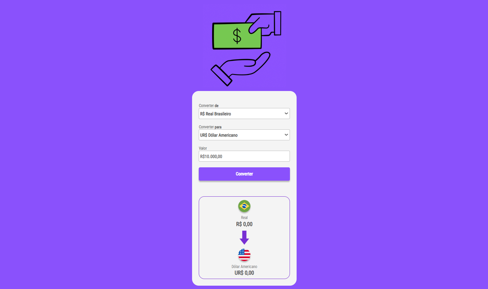

# 💰 Conversor de Moedas em Tempo Real (RealTime Currency Converter)

  

## 🚀 Sobre o Projeto

Este é um conversor de moedas moderno e interativo, desenvolvido para fornecer **taxas de câmbio atualizadas em tempo real**. Diferente dos conversores estáticos, este projeto se conecta a uma API externa para garantir que você sempre tenha as informações mais precisas para suas conversões.

Foi desenvolvido como parte do aprendizado na DevClub, aplicando conceitos de desenvolvimento web e integração com APIs.

## ✨ Funcionalidades

*   **Conversão em Tempo Real:** Obtenha as taxas de câmbio mais recentes graças à integração com uma API de câmbio.

*   **Múltiplas Moedas:** Suporte para converter entre diversas moedas globais (ex: USD, EUR, BRL, JPY, etc.).

*   **Interface Intuitiva:** Design limpo e fácil de usar.

*   **Atualização Automática:** As taxas são buscadas e atualizadas dinamicamente.

## 🛠️ Tecnologias Utilizadas

*   **Linguagem:** `HTML5`, `CSS3`, `JavaScript ES6+`

*   **API de Câmbio:** `AwesomeAPI` 

